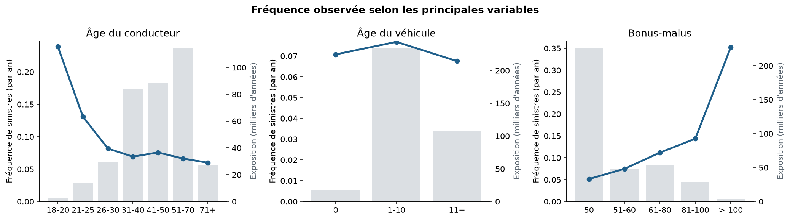
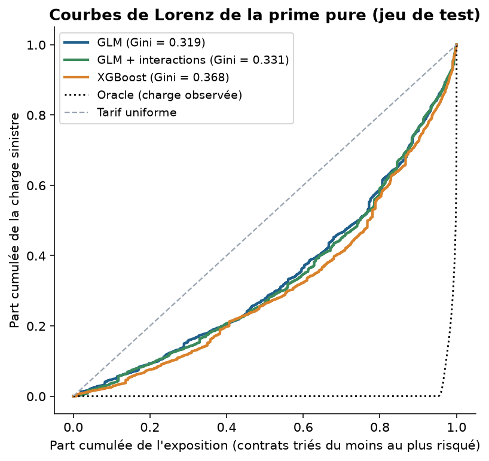
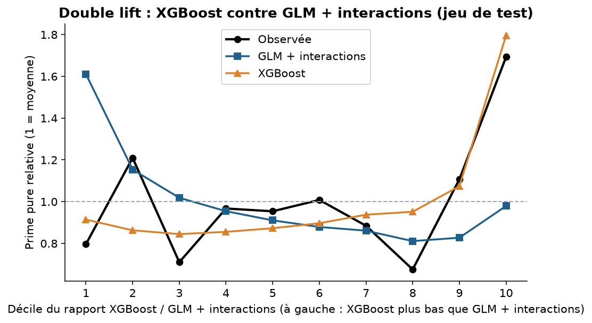
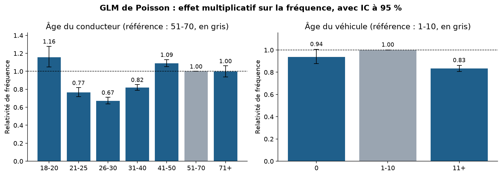

# Tarification automobile : GLM fréquence × coût et comparaison avec XGBoost

Construction d'une **prime pure** d'assurance automobile sur les données publiques **freMTPL2** (678 013 contrats français), avec l'approche actuarielle classique **fréquence × coût moyen** :

- un **GLM de Poisson** pour la fréquence et un **GLM Gamma** pour le coût moyen, lisibles sous forme de relativités ;
- un **GLM enrichi** (interactions avec le bonus-malus) ;
- la même structure avec **XGBoost** (objectifs Poisson et Gamma) ;
- une comparaison sur un jeu de test : déviances, indice de **Gini** avec intervalles de confiance par bootstrap, **calibration**, **double lift**, et interprétation de XGBoost par les valeurs **SHAP** ;
- un traitement des **sinistres graves** : écrêtement puis surcharge mutualisée.



## Résultats

Jeu de test : 136 138 contrats (20 %), jamais utilisés pour l'entraînement ni pour le choix des modèles.

| | Modèle constant | GLM | GLM + interactions | XGBoost |
|---|---|---|---|---|
| Déviance de Poisson (fréquence) | 0,4789 | 0,4590 (−4,2 %) | 0,4570 (−4,6 %) | **0,4484 (−6,4 %)** |
| Déviance Gamma (coût moyen) | 1,4235 | 1,4376 | 1,4376 | 1,4196 |
| Gini de la prime pure | – | 0,319 | 0,331 | **0,368** |
| IC 95 % du Gini (bootstrap) | – | [0,271 ; 0,368] | [0,287 ; 0,378] | [0,325 ; 0,413] |
| Charge prédite / observée | – | 0,994 | 0,994 | 0,992 |

Les écarts de Gini sont significatifs (bootstrap apparié, 200 tirages) : GLM + interactions − GLM = +0,012 [+0,006 ; +0,018], XGBoost − GLM + interactions = +0,036 [+0,010 ; +0,062].

**Ce qu'il faut retenir**

- **La fréquence porte l'essentiel du signal.** XGBoost gagne nettement : il capte des interactions et des effets non linéaires qu'un GLM ne voit pas, même enrichi.
- **Ajouter quelques interactions au GLM réduit un tiers de l'écart** avec XGBoost (Gini 0,319 → 0,331), sans perdre la lisibilité d'une grille tarifaire.
- **Le coût moyen est presque imprévisible avec ces variables** : aucun modèle ne fait vraiment mieux qu'un coût constant. C'est un résultat connu sur freMTPL2 (environ 25 000 sinistres, très dispersés). Le GLM de coût a donc été volontairement simplifié (choix par validation croisée à 5 plis sur le jeu d'entraînement).
- **Le double lift confirme l'avantage de XGBoost là où les deux tarifs divergent** : sur les 10 % de contrats où XGBoost est le plus bas par rapport au GLM, la charge observée vaut 0,80 fois la moyenne ; XGBoost prédit 0,91, le GLM 1,61.

| Courbes de Lorenz | Double lift |
|---|---|
|  |  |


### Lecture du GLM de fréquence



- **Bonus-malus** : chaque point multiplie la fréquence par 1,028 ; passer de 50 à 100 multiplie la fréquence attendue par environ 4. C'est de loin la variable la plus discriminante, comme le confirme SHAP.
- **Âge du conducteur** : les 18-20 ans n'ont qu'une relativité de 1,16 *toutes choses égales par ailleurs*, alors que leur fréquence observée est presque quatre fois plus élevée. Une grande partie de cet effet est déjà portée par leur bonus-malus élevé : c'est l'intérêt d'un modèle multivarié.
- **Véhicule diesel** : +18 % de fréquence à profil égal.

La table complète des relativités, avec intervalles de confiance, est dans [`outputs/relativites_glm_frequence.csv`](outputs/relativites_glm_frequence.csv).


### Sinistres graves

Les modèles sont entraînés sur des montants écrêtés à 200 000 € : quelques sinistres de plusieurs millions d'euros déstabiliseraient sinon le modèle de coût. La part au-delà du seuil n'est pas perdue : elle est **mutualisée** par une surcharge proportionnelle de **+15,4 %**, estimée sur le jeu d'entraînement. Avec cette surcharge, le tarif XGBoost couvre 102 % de la charge brute du jeu de test.

## Méthode

**Données** (OpenML [41214](https://www.openml.org/d/41214) et [41215](https://www.openml.org/d/41215), issues du package R CASdatasets)

- une ligne par contrat, avec son exposition (fraction d'année) et ses caractéristiques : âge du conducteur, bonus-malus, âge et puissance du véhicule, marque, carburant, zone, densité de population, région ;
- une table des montants de sinistres, agrégée par contrat.

**Préparation**

- exposition plafonnée à 1 an ; nombre de sinistres plafonné à 4 ;
- on ne garde que les sinistres ayant un montant connu, pour que fréquence et coût portent sur les mêmes sinistres ;
- pour le GLM : âges en classes (effets non linéaires), bonus-malus plafonné à 150, log de la densité ; niveaux de référence = classes les plus exposées.

**Modèles**

| | Fréquence | Coût moyen |
|---|---|---|
| GLM (statsmodels) | Poisson, lien log, offset log(exposition) | Gamma, lien log, pondéré par le nombre de sinistres |
| GLM + interactions | idem + bonus-malus × âge du conducteur, bonus-malus × âge du véhicule, termes quadratique et cubique du bonus-malus | idem GLM |
| XGBoost | `count:poisson`, log(exposition) en `base_margin`, arrêt précoce | `reg:gamma`, pondéré par le nombre de sinistres, arrêt précoce |

Prime pure = fréquence × coût moyen, puis **correction d'équilibre** : un coefficient global, calculé sur le jeu d'entraînement, pour que la charge prédite égale la charge observée.

**Choix des modèles sans toucher au jeu de test**

- interactions du GLM : comparées sur une validation interne au jeu d'entraînement (déviance et AIC) ;
- variables du GLM de coût : validation croisée à 5 plis ;
- XGBoost : petite grille (profondeur 3 à 7, poids minimal des feuilles 20 à 100) avec arrêt précoce ; les écarts entre réglages sont inférieurs à 0,2 %, le réglage retenu (profondeur 5) est donc robuste.

## Lancer le projet

```bash
python -m venv .venv
.venv\Scripts\activate            # Windows (source .venv/bin/activate sous Linux / macOS)
pip install -r requirements.txt

python main.py                    # télécharge les données (une fois), entraîne, écrit outputs/
python -m pytest                  # tests unitaires
```

Durée : environ 3 minutes sur un ordinateur portable.

## Structure

```
├── main.py                 # pipeline complet
├── src/
│   ├── data.py             # téléchargement OpenML, nettoyage, jointure fréquence / coût
│   ├── features.py         # variables tarifaires (classes, plafonds, références, interactions)
│   ├── models.py           # GLM et XGBoost, relativités, SHAP
│   ├── evaluation.py       # déviances, Lorenz, Gini, bootstrap, calibration, double lift
│   └── plots.py            # figures
├── tests/                  # tests unitaires (pytest)
├── outputs/                # figures, métriques (metrics.json), relativités
└── requirements.txt
```

## Limites et pistes

- Les sinistres graves sont mutualisés par une surcharge uniforme ; modéliser leur queue (loi de Pareto généralisée au-delà du seuil) permettrait d'affiner.
- La variable région pourrait être lissée spatialement plutôt que traitée comme 22 modalités indépendantes.
- Un GAM (effets lisses de l'âge et du bonus-malus) serait un bon compromis entre la lisibilité du GLM et la performance de XGBoost.

## Outils

Python · pandas · statsmodels · XGBoost · scikit-learn · Matplotlib
