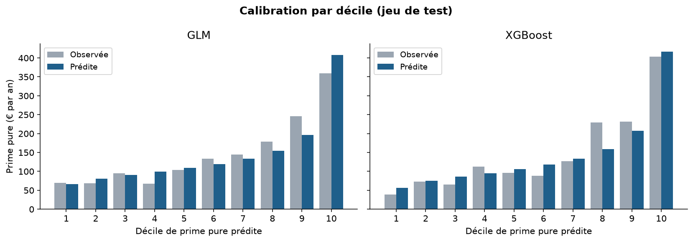
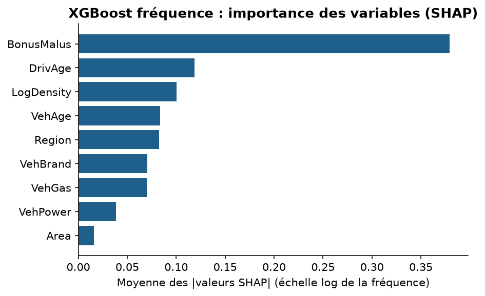

# Tarification automobile : GLM fréquence × coût et comparaison avec XGBoost

Construction d'une **prime pure** d'assurance automobile sur les données publiques **freMTPL2** (678 013 contrats français), avec l'approche actuarielle classique **fréquence × coût moyen** :

- un **GLM de Poisson** pour la fréquence et un **GLM Gamma** pour le coût moyen, lisibles sous forme de relativités ;
- la même structure avec **XGBoost** (objectifs Poisson et Gamma) ;
- une comparaison sur un jeu de test : déviances, indice de **Gini** de la prime pure, **calibration** par décile, et interprétation de XGBoost avec les valeurs **SHAP**.


## Résultats

Jeu de test : 136 138 contrats (20 %), jamais utilisés pour l'entraînement ni pour le choix des modèles.

| | Modèle constant | GLM | XGBoost |
|---|---|---|---|
| Déviance de Poisson (fréquence) | 0,4789 | 0,4590 (−4,2 %) | **0,4484 (−6,4 %)** |
| Déviance Gamma (coût moyen) | 1,4235 | 1,4376 (+1,0 %) | 1,4196 (−0,3 %) |
| Gini de la prime pure | – | 0,319 | **0,368** |
| Charge prédite / charge observée | – | 0,994 | 0,992 |

**Ce qu'il faut retenir**

- **La fréquence porte l'essentiel du signal.** XGBoost gagne nettement sur la fréquence : il capte des interactions et des effets non linéaires (bonus-malus × âge, densité) qu'un GLM sans interactions ne voit pas.
- **Le coût moyen est presque imprévisible avec ces variables.** Aucun modèle ne fait vraiment mieux qu'un coût constant ; c'est un résultat connu sur freMTPL2, dû au faible nombre de sinistres (environ 25 000) et à leur forte dispersion. Le GLM de coût a été volontairement simplifié (choix par validation croisée à 5 plis sur le jeu d'entraînement).
- **XGBoost classe mieux les risques** (Gini 0,368 contre 0,319), mais **le GLM reste plus lisible** : chaque coefficient est une relativité directement utilisable dans une grille tarifaire.

| Courbes de Lorenz | Calibration par décile |
|---|---|
|  |  |

### Lecture du GLM de fréquence


- **Bonus-malus** : chaque point multiplie la fréquence par 1,028 ; passer de 50 à 100 multiplie la fréquence attendue par environ 4. C'est de loin la variable la plus discriminante, comme le confirme SHAP.
- **Âge du conducteur** : les 18-20 ans n'ont qu'une relativité de 1,16 *toutes choses égales par ailleurs*, alors que leur fréquence observée est presque quatre fois plus élevée. Une grande partie de cet effet est déjà portée par leur bonus-malus élevé : c'est l'intérêt d'un modèle multivarié.
- **Véhicule diesel** : +18 % de fréquence à profil égal.

La table complète des relativités, avec intervalles de confiance, est dans [`outputs/relativites_glm_frequence.csv`](outputs/relativites_glm_frequence.csv).



## Méthode

**Données** (OpenML [41214](https://www.openml.org/d/41214) et [41215](https://www.openml.org/d/41215), issues du package R CASdatasets)

- une ligne par contrat, avec son exposition (fraction d'année) et ses caractéristiques : âge du conducteur, bonus-malus, âge et puissance du véhicule, marque, carburant, zone, densité de population, région ;
- une table des montants de sinistres, agrégée par contrat.

**Préparation**

- exposition plafonnée à 1 an ; nombre de sinistres plafonné à 4 ;
- sinistres graves écrêtés à 200 000 € pour stabiliser le modèle de coût ;
- on ne garde que les sinistres ayant un montant connu, pour que fréquence et coût portent sur les mêmes sinistres ;
- pour le GLM : âges en classes (effets non linéaires), bonus-malus plafonné à 150, log de la densité ; niveaux de référence = classes les plus exposées.

**Modèles**

| | Fréquence | Coût moyen |
|---|---|---|
| GLM (statsmodels) | Poisson, lien log, offset log(exposition) | Gamma, lien log, pondéré par le nombre de sinistres |
| XGBoost | `count:poisson`, log(exposition) en `base_margin`, arrêt précoce | `reg:gamma`, pondéré par le nombre de sinistres, arrêt précoce |

Prime pure = fréquence × coût moyen, puis **correction d'équilibre** : un coefficient global, calculé sur le jeu d'entraînement, pour que la charge prédite égale la charge observée.

## Lancer le projet

```bash
python -m venv .venv
.venv\Scripts\activate            # Windows (source .venv/bin/activate sous Linux / macOS)
pip install -r requirements.txt

python main.py                    # télécharge les données (une fois), entraîne, écrit outputs/
python -m pytest                  # tests unitaires
```

Durée : environ 2 minutes sur un ordinateur portable.

## Structure

```
├── main.py                 # pipeline complet
├── src/
│   ├── data.py             # téléchargement OpenML, nettoyage, jointure fréquence / coût
│   ├── features.py         # variables tarifaires (classes, plafonds, références)
│   ├── models.py           # GLM et XGBoost, relativités, SHAP
│   ├── evaluation.py       # déviances, Lorenz, Gini, calibration
│   └── plots.py            # figures
├── tests/                  # tests unitaires (pytest)
├── outputs/                # figures, métriques (metrics.json), relativités
└── requirements.txt
```

## Limites et pistes

- Pas d'interactions dans le GLM : en ajouter (bonus-malus × âge) réduirait l'écart avec XGBoost tout en restant lisible.
- Les sinistres graves sont simplement écrêtés ; un traitement séparé (loi de Pareto au-delà d'un seuil, mutualisation de la surcharge) serait plus rigoureux.
- La variable région pourrait être lissée spatialement plutôt que traitée comme 22 modalités indépendantes.

## Outils

Python · pandas · statsmodels · XGBoost · scikit-learn · Matplotlib
